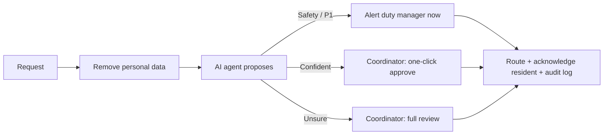

# AI Process Redesign: Resident Service Requests

A consulting-style case study and working prototype: redesigning how a residential building handles
resident service requests, using an AI triage agent with human approval.

It covers the full arc of an AI transformation engagement: **current-state analysis → scored AI
opportunities → future-state design with controls → value case → working prototype → evaluation
against go-live gates.**

> All data is synthetic and the organisation is generic (a 450-bed residential building). No employer
> or real resident data is used.

## The problem in three numbers

From a six-month synthetic request log ([current state](docs/01_current_state.md)):

* **78 minutes:** median time before an *urgent* request sent by email is even read; 64% wait over an hour.
* **18%** of requests go to the wrong team first time.
* **~156 coordinator hours a month** go on reading, re-typing, forwarding and answering chasers.

Root cause: every request needs a person to read it before anyone knows whether it is urgent.

## The redesign

An AI agent reads every request on arrival and **proposes** a category, priority, owning team and a
draft reply. A coordinator **decides**. Safety issues bypass the queue and alert the duty manager
immediately. Personal data is removed before the model sees anything, and every proposal, decision and
override is logged. ([future state](docs/03_future_state.md))



## Results

**Value case (base scenario):** coordinator effort falls from 156 to 64 hours a month, net value about
EUR 26,800 a year on an EUR 11,000 build, payback in about 5 months (low scenario: under 10 months).
([value case](docs/04_value_case.md))

**Prototype evaluation** on 80 hand-labelled requests ([evaluation](docs/05_evaluation.md)):

| Metric | Keyword baseline | Gate |
|---|---|---|
| Category accuracy | 88.7% | |
| Quick-approve precision | 98.3% | >= 95% ✅ |
| P1 (urgent) recall | 69.2% | >= 95% ❌ |
| Safety escalation recall | 72.7% | >= 95% ❌ |

The baseline routes routine requests well but misses urgent ones described in ordinary words ("a man I
don't know followed me in"). **It fails the safety gate, so it must not go live alone.** That finding
is the reason for the LLM classifier with a rule-based safety net and human review, evaluated with the
same harness.

## Deliverables

| | |
|---|---|
| [docs/01_current_state.md](docs/01_current_state.md) | As-is process map, baseline KPIs, pain points, root causes |
| [docs/02_opportunities.md](docs/02_opportunities.md) | 8 AI/automation opportunities scored on value, feasibility, data readiness, risk, adoption |
| [docs/03_future_state.md](docs/03_future_state.md) | To-be process: what people, the AI agent and automation each do; controls |
| [docs/04_value_case.md](docs/04_value_case.md) | Value tree, business case with scenarios, KPI framework, benefits tracking |
| [docs/05_evaluation.md](docs/05_evaluation.md) | Evaluation method, results, error analysis, limitations |
| [deck/](deck/) | 10-slide summary for senior stakeholders |
| `src/triage/` | The triage agent prototype |
| `src/case_study/` | Synthetic data, baseline, opportunity scoring and business case (every number above) |

## Run it

```bash
pip install -r requirements.txt
export PYTHONPATH=src            # Windows PowerShell: $env:PYTHONPATH="src"

python -m pytest                                 # 12 tests
python -m triage.evaluate                        # keyword baseline, no API key needed
python -m triage.review "I can smell gas in kitchen 2, call me on 087 555 1234"
python -m triage.review --file data/sample_inbox.csv
python -m case_study.run                         # regenerate data, baseline, scores, business case

# LLM classifier (Anthropic or OpenAI)
export ANTHROPIC_API_KEY=...     # or OPENAI_API_KEY
python -m triage.evaluate --llm
python -m case_study.run         # business case picks up the LLM results automatically
```

## How the agent works

1. **Redact** emails, phone numbers, IBANs, card numbers and Eircodes (`redact.py`).
2. **Classify** into one of 11 categories and 3 priorities, with a confidence and a safety flag.
   `BaselineClassifier` uses transparent keyword rules; `LLMClassifier` asks a model for JSON, validates
   it against a schema and falls back to the baseline on any failure (`classifier.py`).
3. **Safety net:** rule-based safety signals can only add an escalation on top of the model, never remove one.
4. **Decide the human step:** `ESCALATE_NOW` (safety or P1), `QUICK_APPROVE` (confidence >= 0.6) or
   `FULL_REVIEW` (`agent.py`).
5. **Draft a reply** with the owning team and target response time.
6. **Log** every proposal and every human decision, including overrides, to a JSONL audit log.

## Project structure

```
data/        test_set.csv (80 labelled), synthetic_request_log.csv (6 months), sample_inbox.csv
docs/        the five case-study documents
deck/        slide deck
outputs/     evaluation reports, KPIs, opportunity scores, business case, charts
src/triage/      taxonomy, redact, classifier, agent, review CLI, evaluate
src/case_study/  assumptions, run (data generation, baseline, scoring, business case)
tests/       pytest suite
```

## Limitations

Synthetic data throughout; a small test set written by the same author as the keyword rules (so the
baseline is optimistic); pattern-based redaction that does not catch names; English only. See
[evaluation](docs/05_evaluation.md#55-limitations) for what a real pilot would need.
