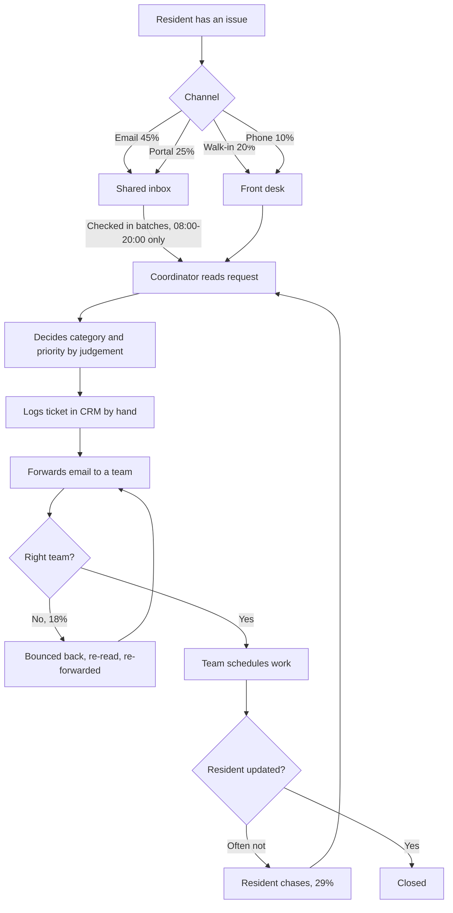
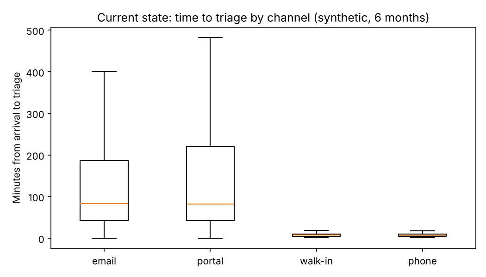

# 1. Current state: how service requests are handled today

**Scope.** Resident service requests in a generic 450-bed residential building (student / co-living
style): from the moment a resident reports something to the moment the right team owns it.
Fixing the issue itself is out of scope; getting it to the right people, at the right priority,
quickly, is in scope.

**Data.** There is no real organisation behind this case. The process is a typical one for this kind
of operation, and the numbers come from a six-month synthetic request log
(`data/synthetic_request_log.csv`, 7,894 requests) generated from the assumptions in
`src/case_study/assumptions.py`. Every figure below is reproduced by `python -m case_study.run`.

## 1.1 Process map (as-is)

## 1.2 Baseline (six months, synthetic)

| Measure | Value |
|---|---|
| Requests | 7,894 (about 1,320 a month; September move-in month 60% higher) |
| Arrive through the shared inbox (email or portal) | 69.9% |
| Arrive outside desk hours (20:00-08:00) | 30.0% |
| Median time from arrival to triage | 48 minutes |
| 90th percentile time to triage | 647 minutes (about 11 hours: overnight email) |
| **Urgent (P1) requests arriving by inbox: median time to triage** | **78 minutes** |
| **Urgent (P1) inbox requests waiting more than an hour** | **63.7%** |
| Sent to the wrong team first time | 18.2% |
| Logged with an inconsistent priority | 25.4% |
| Residents who chase for an update | 28.9% |
| Coordinator time on triage, rework and chasers | about 156 hours a month |

## 1.3 Pain points and root causes

| # | Pain point | Root cause | Evidence |
|---|---|---|---|
| 1 | Urgent issues sit in the inbox | Inbox is worked in batches and not at all overnight; nothing separates urgent from routine on arrival | P1 inbox median 78 min, 64% wait over an hour |
| 2 | Requests go to the wrong team | Category decided by individual judgement; no shared definitions; free-text requests are ambiguous | 18% misrouted; each bounce costs ~9 min and 2-24 hours of delay |
| 3 | Priorities are inconsistent | No written priority rules; depends who is on shift | 25% inconsistent |
| 4 | Residents chase | No acknowledgement or expected response time | 29% chase; each chaser restarts the loop |
| 5 | Coordinators spend most of their time on admin | Reading, re-typing into the CRM and forwarding is manual | ~156 hours a month (about one full-time person) |
| 6 | Management can't see performance | Category and priority are unreliable, so reports are too | No trustworthy KPI report today |

**Root-cause summary (5 whys, pain point 1).** Why did a ceiling leak wait 80 minutes? It was in the
inbox. Why was it not seen? The inbox is checked every couple of hours. Why? Coordinators are at the
desk and work the inbox between walk-ins. Why is the inbox not triaged on arrival? Every request needs
a person to read it before anyone knows it is urgent. **Root cause: the first read of every request
is manual, so urgency is only discovered when a person gets to it.** This is the step AI can change.
