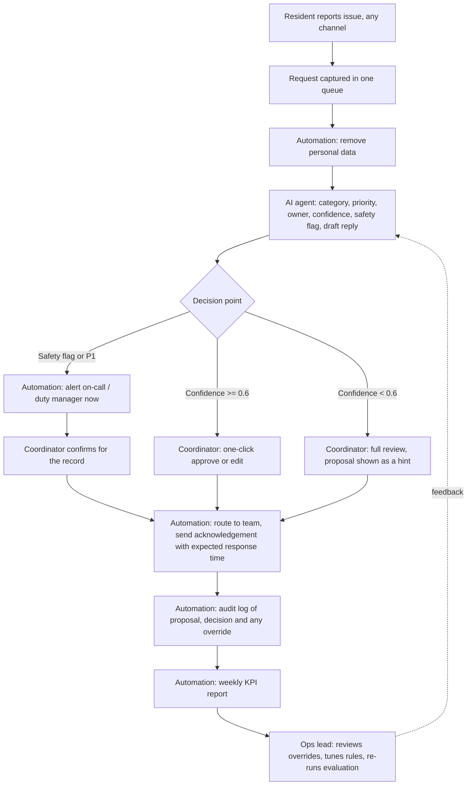

# 3. Future state: people, AI agent and automation

**Design principle: the agent proposes, a person decides.** In the first release no request is routed
without a coordinator's approval. The agent removes the manual first read, so urgency is known on
arrival, and turns most triage into a one-click check.

## 3.1 Process map (to-be)

## 3.2 Who does what

| Step | Person | AI agent | Automation |
|---|---|---|---|
| Capture | Resident submits | | All channels land in one queue; walk-ins and calls logged by desk |
| Protect data | | | Emails, phone numbers, IBANs, card numbers, Eircodes removed before the model sees text |
| First read | | Proposes category, priority, owner, confidence, safety flag, draft reply | |
| Urgent items | Duty manager acts; coordinator confirms | Flags safety risk | Immediate alert, no queue |
| Routine items | Coordinator approves, edits or rejects | Proposal and one-line rationale | |
| Routing and reply | Coordinator can edit reply | Draft reply | Sends to team; resident gets acknowledgement and target time |
| Record | | | Every proposal, decision and override logged |
| Improve | Ops lead reviews overrides weekly, owns the rules | | KPI report, evaluation re-run |

## 3.3 Decision points and controls

| Control | Why | Where in the code |
|---|---|---|
| Human approval of every routing decision (release 1) | Errors are caught before they reach a team | `agent.py`, `record_decision` |
| Safety and P1 bypass the queue | The worst failure is an urgent issue waiting | `agent.py`, `review_mode` |
| Rule-based safety net on top of the model | Keyword safety signals can only *add* an escalation, never remove one | `classifier.py`, `LLMClassifier.classify` |
| Confidence threshold (0.6) | Uncertain proposals get a full review instead of a one-click approval | `agent.py` |
| PII removed before model calls and logging | GDPR data minimisation | `redact.py` |
| Validated structured output, fallback on failure | A bad model reply never drops a request | `classifier.py`, `validate` |
| Full audit log with overrides | Accountability and data for improving the agent | `outputs/audit_log.jsonl` |
| Go-live gate | Pilot only if P1 recall >= 95% and quick-approve precision >= 95% on the test set | `docs/05_evaluation.md` |

## 3.4 Taxonomy

11 categories, 6 owning teams, 3 priority levels. Definitions are in `src/triage/taxonomy.py`; written
priority rules replace individual judgement (pain point 3).

| Priority | Rule | First response target |
|---|---|---|
| P1 Urgent | Risk to people or property, or resident cannot access or use their room | 1 hour |
| P2 High | Essential service degraded, or money at stake | 8 hours |
| P3 Standard | Everything else | 48 hours |

## 3.5 What changes for people

* **Coordinators** move from reading, typing and forwarding to checking and deciding. Their judgement
  is still the final say, and their overrides are what improves the agent.
* **Residents** get an instant acknowledgement with who has their request and when to expect a reply.
* **Team leads** receive requests that are already categorised and prioritised consistently.
* **Adoption plan:** two-week shadow mode (agent proposes, coordinators work as today, both recorded),
  then a pilot on email and portal only, then all channels.
