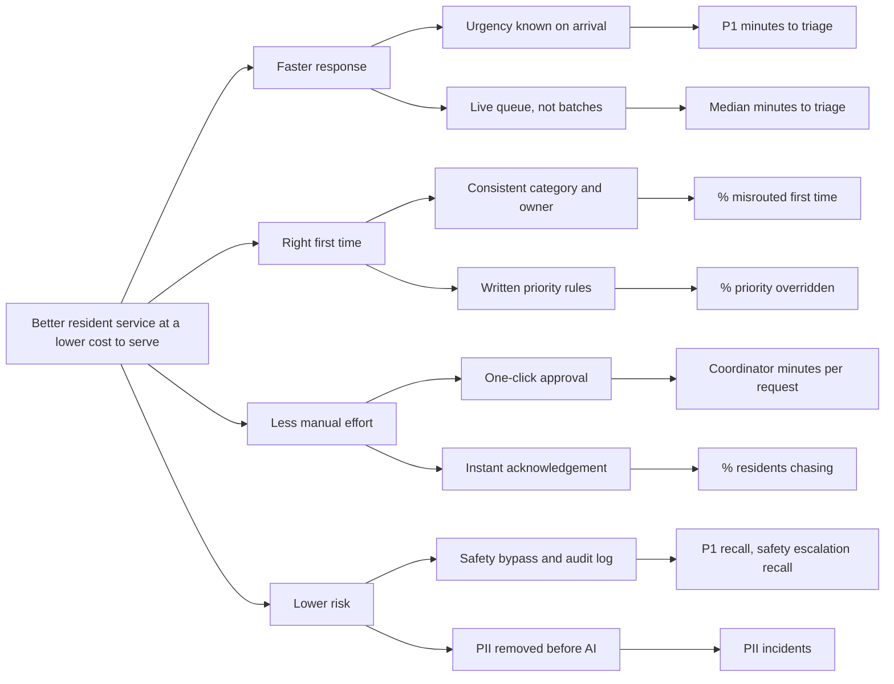
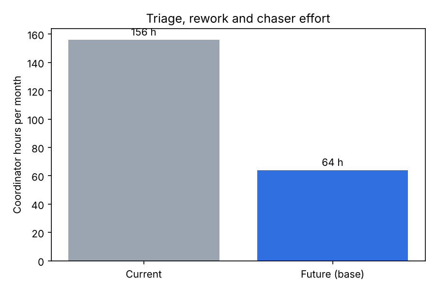

# 4. Value case

All figures are produced by `python -m case_study.run` from the assumptions in
`src/case_study/assumptions.py` and the evaluation results in `outputs/`. They are illustrative for a
generic 450-bed building, not measurements from a real organisation.

## 4.1 Value tree

## 4.2 Effort: current vs future (base case)

| Driver | Current | Future | Source |
|---|---|---|---|
| Coordinator minutes per request (triage) | 4.0 | 1.46 | Review-mode mix from the evaluation x minutes per mode |
| Misrouted first time | 18.2% | 5.6% | Assumes reviewers miss half of the agent's category errors |
| Residents chasing | 28.9% | 18.8% | 35% fewer chasers with instant acknowledgement |
| **Coordinator hours a month** | **156** | **64** | |
| Urgent inbox requests: time to triage | 78 min median | target under 10 min | Agent runs on arrival; P1 bypasses the queue |

## 4.3 Business case

One-off build: 20 days at EUR 550 = **EUR 11,000** (discovery, build, evaluation, CRM integration,
training). Running cost: hosting and monitoring, model usage (about EUR 0.002 per request) and two
support days a quarter = **about EUR 6,200 a year**. Time is valued at EUR 30 an hour loaded cost.

| Scenario | Hours saved / month | FTE | Net value / year | Payback | 3-year net |
|---|---|---|---|---|---|
| Low (60% of modelled saving) | 55 | 0.37 | EUR 13,600 | 9.7 months | EUR 29,700 |
| **Base** | **92** | **0.61** | **EUR 26,800** | **4.9 months** | **EUR 69,400** |
| High (125%) | 115 | 0.76 | EUR 35,000 | 3.8 months | EUR 94,100 |

**How to read this.** The saving is capacity, not headcount: about 0.6 of a coordinator's time moves
from admin to residents, out-of-hours cover and follow-up. The larger benefit is not in the euro figure
at all: urgent issues stop waiting in an inbox.

**What would break the case.** The low scenario still pays back within a year. The case fails if
coordinators do not trust the proposals and re-read every request (quick approvals take as long as
today), which is why quick-approve precision is a go-live gate and shadow mode comes first.

## 4.4 KPI framework and benefits tracking

| KPI | Baseline | Target (3 months after go-live) | Owner | Source | Frequency |
|---|---|---|---|---|---|
| P1 median minutes to triage | 78 (inbox) | < 10 | Ops lead | Audit log timestamps | Weekly |
| P1 recall (urgent marked urgent) | n/a | >= 95% | Ops lead | Weekly sample of 50 decisions | Weekly |
| Median minutes to triage | 48 | < 15 | Ops lead | Audit log | Weekly |
| Misrouted first time | 18.2% | < 7% | Team leads | Reassignments in CRM | Monthly |
| Share of proposals overridden | n/a | < 15% and falling | Ops lead | Audit log `overridden` | Weekly |
| Coordinator minutes per request | 4.0 | < 2.0 | Front desk manager | Time sample, 1 day a month | Monthly |
| Residents chasing | 28.9% | < 20% | Front desk manager | CRM follow-ups | Monthly |
| PII found in logs | n/a | 0 | Data protection lead | Monthly log scan | Monthly |

**Benefits tracking.** Measure the baseline during the two-week shadow period with real data (this
replaces the synthetic figures above). Report the KPIs weekly for the first three months, then monthly.
Benefits are counted only after the pilot passes its gate, and the hours saved are checked by a time
sample rather than taken from the model.
